# Tower Bridge - An Architectural Marvel

A comprehensive three-dimensional (3D) digital model of London's iconic Tower Bridge, developed using industry-standard computer-aided design (CAD) software. This project bridges history, architecture, and technology to offer an educational, immersive visual experience.

## Development Workflow & Implementation

### 1. Data Collection & Baseline Setup
The workflow begins by importing an authentic architectural blueprint of Tower Bridge into AutoCAD as the foundational background reference frame.

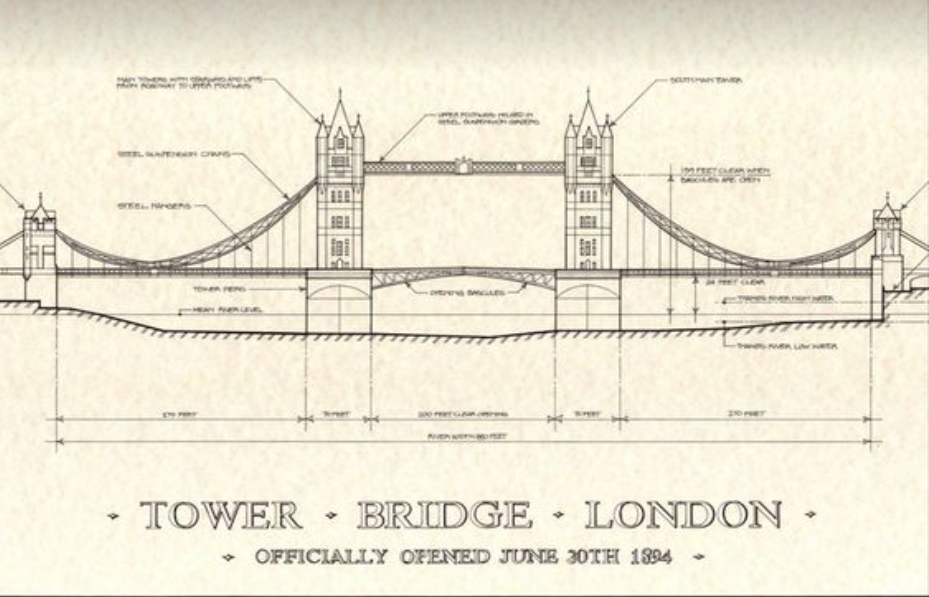

### 2. Dimensioning & Measurement Extraction
Precise measurement boundaries are calculated directly on top of the reference schema to derive accurate component scales.

| Measuring Structural Profiles | Generating Initial Wireframe Profiles |
| :---: | :---: |
| 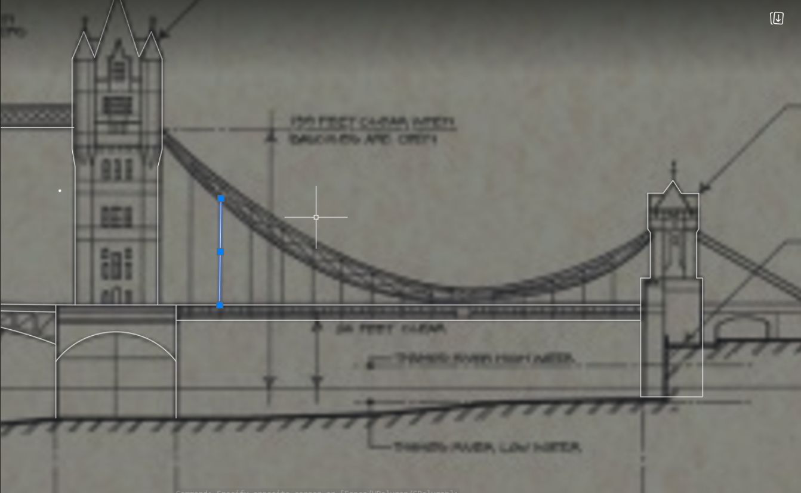 | 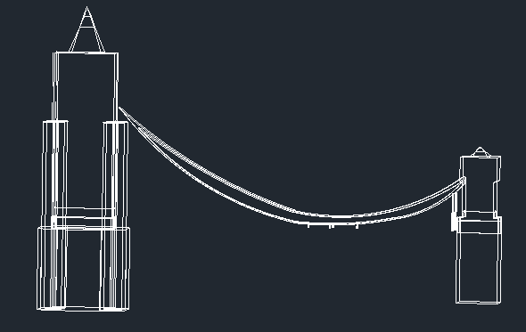 |
| *Figure 2.2: Extracting tower dimensions* | *Figure 2.3: Initial vector outline* |

| Refining Component Vertices | Finalizing Vector Scale Checks |
| :---: | :---: |
| 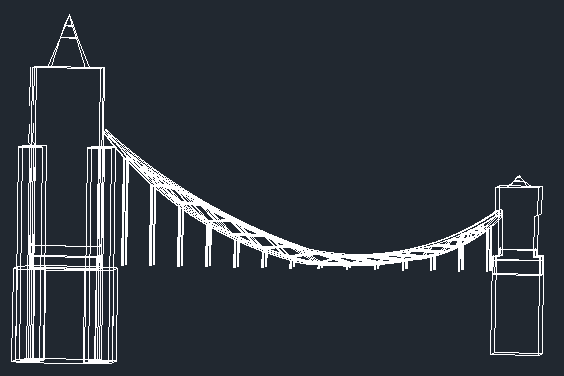 | 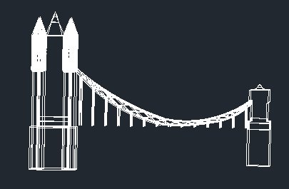 |
| *Figure 2.4: Aligning vertical cables* | *Figure 2.5: Bridge span scaling validation* |

### 3. Solid Modeling & Command Execution
Once the 2D drafting constraints are fully satisfied, the component profiles are extruded and translated into a 3D workspace.

* **3D Extrusion:** Initial structural solids are generated to form the core tower base blocks.
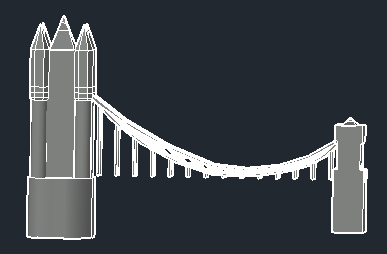

* **Bridge Assembly:** Main support cables and truss elements are structuralized.
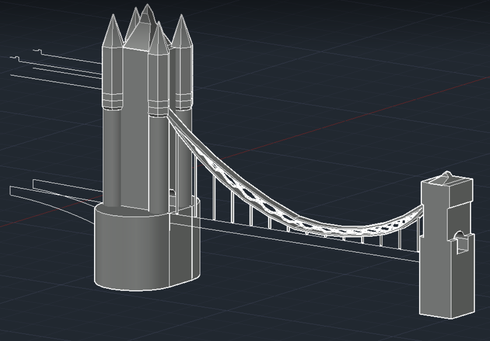

* **Roadway Extrusion:** The `EXTRUDE` command is deployed to carve out the functional spans and transit roadways.
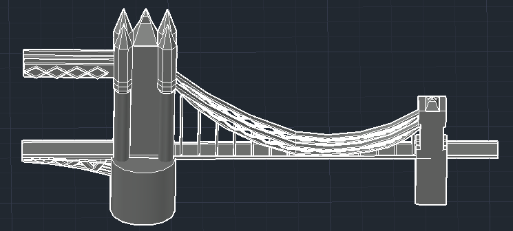

* **Symmetrical Duplication:** The `3D MIRROR` command is utilized across the center reference plane to accurately mirror and complete the full dual-tower architecture.
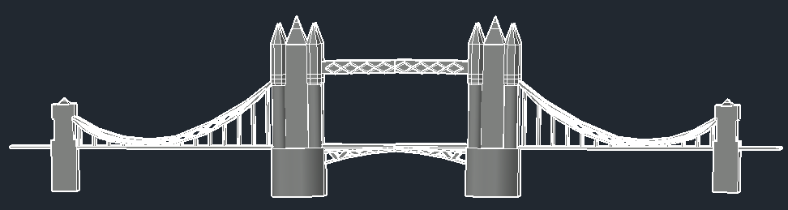

---

## Final Performance Evaluation & Render Results

The finalized model applies realistic texturing parameters along with natural lighting simulations to accurately portray stone features, metallic surfaces, and depth coordinates.

### Orthographic Full View
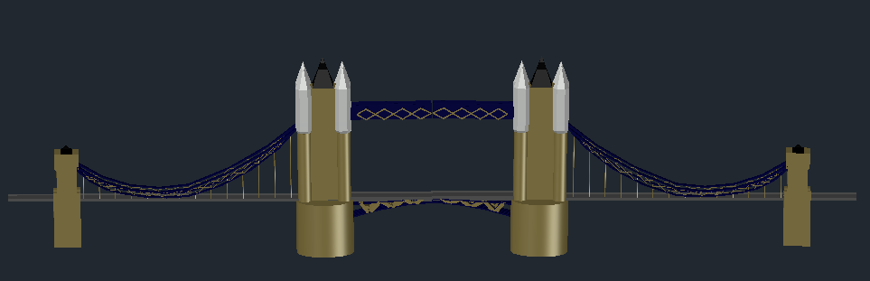

### Perspective Corner Views

| Corner View Left Angle | Corner View Right Angle |
| :---: | :---: |
| 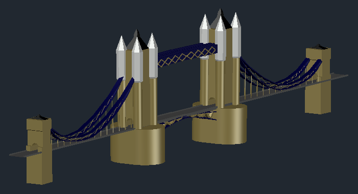 | 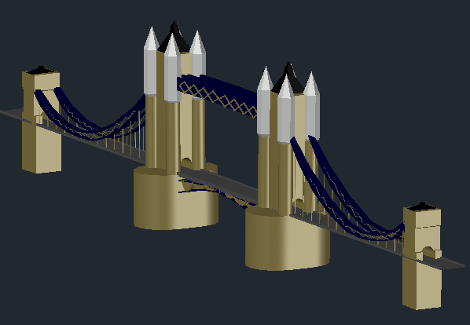 |
| *Figure 3.2: Isometric Perspective A* | *Figure 3.3: Isometric Perspective B* |

---
## Project Overview

This project focuses on modeling the precise architectural complexities of Tower Bridge. By gathering blueprints, photographs, and structural dimensions, the final model reflects accuracy in scale, intricate stonework, and structural elements. It serves as a digital preservation tool and an exploration blueprint for potential design modifications or future AR/VR integrations.

### Key Objectives
* **Precision Modeling:** Replicate real-world dimensions and structural features using CAD frameworks.
* **Historical Accuracy:** Incorporate authentic architectural blueprints to ensure historical fidelity.
* **Interactive Design:** Render high-definition views from multiple angles for comprehensive spatial analysis.

---

## Authors & Acknowledgments

* **Md. Fahad Nakib** (ID: 221902149)
* **Course:** Engineering Drawing Lab (CSE 208), Section: 221-D2
* **Institution:** Green University of Bangladesh, Department of Computer Science and Engineering (CSE)

---

## Tools and Technologies

* **CAD Software:** AutoCAD (Core 2D/3D drafting and solid modeling commands)
* **3D Design Methodologies:** Isometric mapping, laser measurement scaling, texturing, and lighting simulation.

---

## Future Scope

* **AR/VR Integration:** Deploying the model meshes into Unity or Unreal Engine to experience the project via an interactive Virtual Reality tour.
* **Collaborative Design Extensions:** Porting assets to cloud BIM platforms to support multi-stakeholder design reviews.
